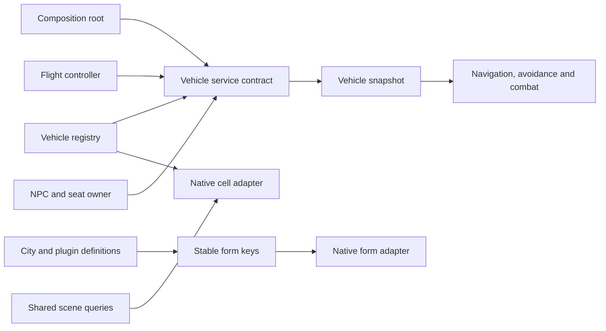

# System connections

The composition root is `main_vehicle.cpp`. It connects providers before
registering frame callbacks and uses the same feature initialization for the
core-attached and standalone paths. Connection changes are main-thread actions.

## Contracts

| Boundary | Contract | Owner of specific details |
|---|---|---|
| Plugin content to runtime forms | `runtimeforms::Key` / `Range` / `Resolve` | `runtimeforms.cpp` uses the game's own full/light/medium conversion; callers never assemble load-order bits |
| Grid traversal to engine memory | `runtimecells::GridSize`, `Cell`, `References` | The adapter contains cell layout/state reads and offset discovery; eligibility policy is explicit |
| Vehicle discovery, ownership and seats to world snapshot | `vehiclelinks::Services` passed to `world::SetServices` | Composition supplies registry/controller/seat callbacks; `vehicleworld.cpp` does not include their implementation headers |
| City selection and geometry | `cityprofile::Definition` and registered definitions | Plugin ranges, placement-world matching, coordinate frame and ring anchor are content data |
| Pilot quests and parked props | `pilotlayout.h`, `parkedlayout.h` | Named plugin-local resources replace heuristic searches through unrelated load-order slots |
| Incremental work | `framework::ScanCursor` and `ScanStep` | Each consumer chooses a bound and supplies an adapter; cursor state contains no engine-array pointer |
| Movement profiles to driving/seating | Existing `vcontract` goal and seat contracts | Profile code supplies goals; controller and seat owners retain execution authority |

## Lifetime and failure behavior

Stable plugin/local keys may be kept between sessions. Runtime IDs must be
resolved in the current session. Reference pointers and cell-array views are
borrowed for the current frame/call; incremental work retains IDs or cursors and
obtains a fresh view when it resumes. Form lookups transfer no ownership. A
subsystem retaining a per-session form cache must invalidate/revalidate it at
the relevant lifecycle boundary; pilot-quest reset drops cached quests and
pending diagnostics before resolving the new session's dependency.

The world service table is copied, and callbacks must outlive its use. Replacing
the table clears the old snapshot and scan state. A save reset clears runtime
state while retaining the connection. Incomplete tables publish no snapshot.
Alternative providers must supply native vehicle references compatible with
the snapshot's scene/physics reader; this is not an arbitrary object-model API.

Missing/unloaded plugins resolve to zero. Checked lookup rejects an object whose
identity does not match. Cell views validate capacity and parent-cell identity;
a fault in one candidate layout does not prevent trying the other supported
layout. Scene queries retain their prior cell-only eligibility, while vehicle
registry/discovery requires a ready grid entry as well.

## Extending content

Shared matching/ring helpers accept registered city definitions rather than
additional world-name branches. Define plugin ranges, world matching, coordinate
frame and anchor there. The current placement builder/controller remains bound
to the New Atlantis definition at build time. A second content definition also
needs explicit builder/controller ownership, the correct world/cell template
and serializer master layout. Registering it alone does not activate traffic or
generate a valid plugin. Only New Atlantis ships today.

For a new quest or content dependency, define a named `runtimeforms::Key` or
`Range`, resolve it through the adapter, and validate its expected form role.
Do not search every plugin for coincidentally matching local IDs or use a
top-byte mask to identify an ESL's content.

Keep engine-version addresses/layouts in the native boundary. Keep policy
(vehicle keyword filtering, placement ownership, seating eligibility, navigation
and combat decisions) in its existing owner. The version-pinned physics and
scene readers remain engine-specific.

## Compatibility and checks

This refactor preserves the existing six pilot quest slots, 32 dedicated city
vehicles, 64 spare vehicles, serialized identities and saved formats. Those
capacities describe current content and are explicit; they are not advertised
as unlimited. The core API ABI is unchanged.

Offline checks cover alternate city definitions, resource ranges, full/light
runtime resolution through a native-shaped fixture, cell policies/layouts,
provider replacement and reset behavior. Existing mandatory Python ESM fixture
and real-recording startup checks remain required. These checks do not establish
live gameplay, save/uninstall safety or frame-rate improvement.

## Live physics observations and timing

`bodymass.h` supplies a fixed-capacity, nonwaiting observation cache. The physics callback reads current chassis inverse mass while native access is already valid, validates the full body generation and dynamic flag, and publishes only identity/mass/time/load epoch. The world sampler matches current scene bodies and accepts observations for at most two seconds. It never caches a physics pointer or invokes the synchronous reference mass visitor. Snapshot mass is the observed chassis mass, rather than the old reference-wide sum; the existing bounds estimate remains the fallback. The physical flight solver continues using its own current native mass/inertia.

`hookcost.h` separates mod-hook and native-step elapsed time and provides bounded per-instance step counters. Contention/capacity loss drops telemetry only; reports count skipped samples. `framepacing.h` measures callback spacing, including delays outside the previous measured task; these are not GPU/present measurements. Load reset clears pacing and invalidates mass epochs. Scene/occupant spike reports also name the slowest reference.

## Native-update admission

`updateschedule.h` keeps a lock-free atomic `Pulse` producer separate from the main-thread `Gate`. The standalone ground/ship-system hook publishes after its native update and probe work complete, including the no-TES return. The core path reuses the existing player-update callback and then publishes. No new hook, queue, worker, engine address, external ABI or user FPS cap is added.

The composition root reads the selected pulse on each raw task callback. One bootstrap is admitted after initialization/reset; thereafter a changed serial admits a full update, subject to a 240 Hz admission ceiling. Every missed serial is coalesced into the current state. There is no catch-up loop or accumulated update debt. Pulse publication remains monotonic across save resets; consumer reset permits one fresh bootstrap. Recursive task callbacks skip rather than re-enter the mutable update pipeline.

The standalone pulse can stop on foot. After 100 ms without a new pulse, clock fallback admits full updates at most 60 times per second so gameplay cannot freeze. Between full updates, settings, input/UI bindings and log housekeeping can run at most 60 times per second without scene discovery or AI/placement jobs. Input sampling retains triggered/started events until the next gameplay batch publishes them; that batch clears them after consumers run. Focus/menu, context, eligibility, binding and load changes discard stale events. Native flight physics, contact handling, camera/model update hooks and game simulation keep their existing paths. A slow consumer performs one current update rather than replaying old frames.

Diagnostics distinguish raw task poll frequency, admitted full update frequency, housekeeping, skipped polls, coalesced native serials and clock fallback. Task wall time includes waits and is not CPU utilization or rendered FPS. `vehicle_probe` separately reports native original versus probe/model elapsed time. `resources.cpp` samples process RAM, system available RAM, page-fault counts, process read throughput and DXGI memory budgets every two seconds while verbose logging is enabled. Fault counts include soft faults; process reads are not disk-only. Slow GPU diagnostics suspend further GPU queries. These readings do not establish a stall's cause. Admission does not bound engine-call duration, rendering, OS scheduling or total frame time. Existing bounded discovery/registry/scene/navigation/beacon/retry work units remain in place.
